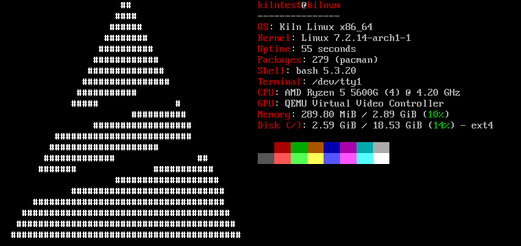

<p align="center">
  <picture>
    <source media="(prefers-color-scheme: dark)" srcset="branding/mark-triangle-light.svg">
    
  </picture>
</p>

<h1 align="center">Kiln Linux</h1>

<p align="center">
  A small Arch Linux distribution with a Void-style installer, a tiling desktop,<br>
  and <code>kiln</code>, which keeps your package sets in plain TOML files.
</p>

<p align="center">
  
</p>

Kiln Linux is Arch underneath. You keep pacman, the official repositories and
the Arch wiki. Kiln adds a live ISO that boots on UEFI and BIOS, an installer
that asks a few questions and sets up systemd-boot, GRUB or Limine, a choice
of seven desktops with [twmx](https://github.com/arcbaseproject/twmx) as the
default, and the `kiln` tool.

The screenshot shows a fresh install with the default twmx desktop: 279
packages, 290 MiB of memory in use at the login console, and no Kiln service
running in the background.

## kiln: package profiles

You write the packages you want in a profile:

```toml
# ~/.config/kiln/profiles/dev.toml
[profile]
name = "dev"
description = "My editor and build tools"

[packages]
official = ["git", "neovim", "base-devel"]
```

Then kiln compares it with the system and lets pacman install what's missing:

```sh
kiln plan dev                  # what would change; changes nothing
sudo kiln apply dev            # pacman installs the missing packages
sudo kiln remove dev --purge   # uninstall what kiln installed for it
```

pacman stays in charge. kiln asks pacman what is installed, runs pacman for
every change, and records only the packages it installed itself. A purge
leaves alone anything you installed by hand and anything another active
profile lists. Run `apply` twice and the second run does nothing.
[docs/kiln.md](docs/kiln.md) covers the rest.

## Desktops

The installer offers these. Each one is a kiln profile, so you can add or
swap one later with `sudo kiln apply <name>`.

| Desktop | Session | Starts with |
|---|---|---|
| **twmx** (default) | X11, tiling | a login on tty1 |
| i3 | X11, tiling | a login on tty1 |
| Sway | Wayland, tiling | a login on tty1 |
| Hyprland | Wayland, tiling | a login on tty1 |
| XFCE | X11 | the LightDM login screen |
| KDE Plasma | Wayland | the SDDM login screen |
| GNOME | Wayland | the GDM login screen |
| None | console | |

twmx is a one-file tiling window manager grown out of TinyWM. On Kiln it
comes with polybar, xterm on Super+Return, dmenu on Super+d, dunst for
notifications, i3lock on Super+Escape and screenshots on Print, in Kiln
Graphite, the dark-and-brick theme every Kiln desktop shares. Kiln builds twmx from a
pinned commit and ships it in a small local `[kiln]` pacman repository.
A daily user timer checks GitHub and builds updates into `~/.local/bin`,
keeping Kiln's colors and your changes to `~/.local/src/twmx/config.h`.
The next X11 login uses the updated build; the running desktop stays open.
Run `/usr/bin/twmx-update` to check now. Disable automatic updates with
`systemctl --user mask --now twmx-update.timer`.

## Install

1. Download or build the ISO and write it to a USB stick:
   `sudo dd if=kilnlinux-*.iso of=/dev/sdX bs=4M conv=fsync status=progress`
   (this erases the stick).
2. Boot it in UEFI mode. The live system logs you in as root.
3. Run `kiln-install`.

The installer opens on a menu of every setting with its current value:
keyboard, network, hostname, locale, time zone, root, user, desktop,
extras, disk and boot loader. Visit them in any order, then pick Install.
You get a summary first, and you type the disk name before the installer
erases anything. For Wi-Fi, the Network item opens `iwctl`.

You can also partition the disk yourself with cfdisk, choose ext4 or btrfs,
encrypt the root partition with LUKS2, and add PipeWire audio or developer
tools. `kiln-install --config FILE` runs the same install with no questions.

## Build it

On Arch Linux, clone with `git clone --recurse-submodules` (or run
`git submodule update --init --recursive` in an existing checkout):

```sh
sudo pacman -S --needed archiso rust base-devel git python
make test      # unit, integration and lint checks
make iso       # writes out/kilnlinux-YYYY.MM.DD-x86_64.iso; no root needed
```

archiso builds inside a user namespace, so `make iso` runs as your user. To
try the result in a VM:

```sh
sudo pacman -S --needed qemu-desktop edk2-ovmf
make run       # boot the ISO (UEFI) with a blank 20 GiB disk
make run-disk  # boot what you installed
make e2e       # install unattended in QEMU, boot it, take screenshots
```

## Repository

```text
archiso/kiln/           archiso profile, derived from upstream releng
packages/kiln/          pinned kiln-package-manager Git submodule (Rust)
packages/kiln-install/  the installer (bash and dialog)
packages/twmx/          PKGBUILD and Kiln's config.h for twmx
profiles/               core, the seven desktops, developer, audio
configs/                home skeleton for new users: .xinitrc, .Xresources, .config
themes/                 Kiln Graphite: the colors, fonts and spacing configs/ is built from
scripts/                build.sh, test.sh, qemu.sh
tests/qemu/             the end-to-end install test
branding/               marks, boot splash, colors
docs/                   architecture, kiln, installing, testing
```

## Documentation

- [Architecture](docs/architecture.md): how the ISO, installer and kiln fit together, and how to change them
- [kiln and pacman](docs/kiln.md): commands, writing profiles, what `--purge` removes
- [Installing](docs/install.md): building, QEMU, USB sticks, the installer menus
- [Testing](docs/testing.md): what we have tested, what we haven't, and resource use
- [Contributing](CONTRIBUTING.md)

## Status

Kiln Linux is young. `make e2e` installs the ISO in QEMU and boots the
result into twmx, and that path works today. Still missing:

- a hosted repository for `[kiln]` package updates; twmx currently updates per user from GitHub
- broader hardware testing

The other six desktops go through the same installer steps, but nobody has
installed each one in a VM yet. [docs/testing.md](docs/testing.md) keeps the
list.

## License

MIT, see [LICENSE](LICENSE). `archiso/kiln/` derives from archiso's releng
profile and stays GPL-3.0-or-later, like archiso.

## Kiln and distro updates

The CLI lives in [kiln-package-manager](https://github.com/kilnlinux/kiln-package-manager).
The distro pins its source as a submodule and installs it as a pacman package.
A daily `kiln-update.timer` installs newer stable CLI release packages after
checking GitHub's SHA-256 asset digest and the package identity. Pacman checks
dependencies and owns every installed file. If newer libraries are needed,
run `sudo pacman -Syu` before retrying the CLI update.

`kiln-update --check` checks the CLI, distro releases and distro source commits
without installing anything. `sudo kiln-update --apply` updates only the CLI;
it reports distro releases without replacing the running system. Cached notices
appear at console login. Logs: `journalctl -u kiln-update.service`.
Disable automatic checks with `sudo systemctl disable --now kiln-update.timer`.
